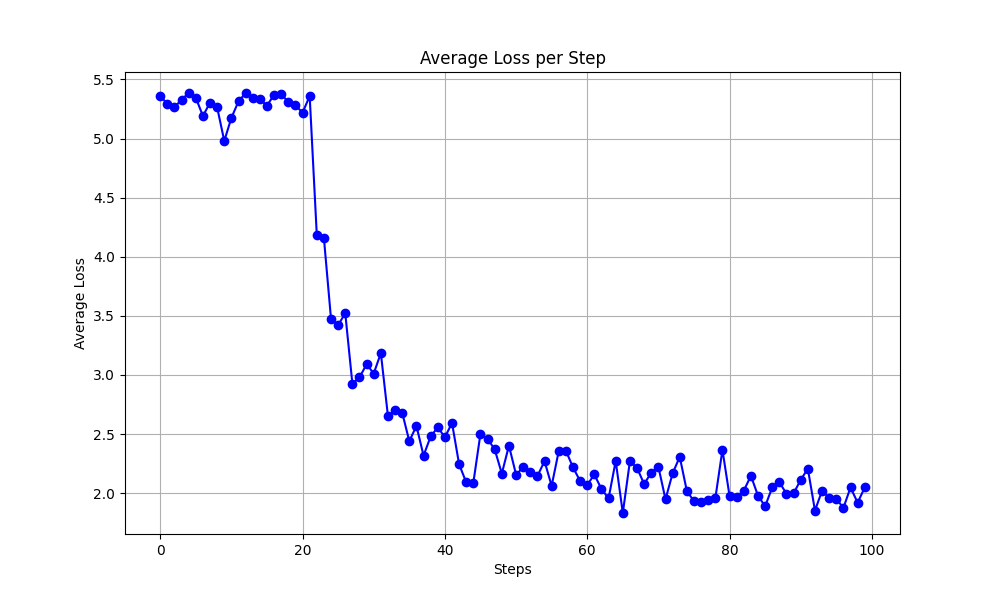

# Distributed Llama 3.1 8B Fine Tuning with DeepSpeed

Multi node supervised fine tuning of **Llama 3.1 8B** using **DeepSpeed ZeRO Stage 3** and **SLURM** across **8 GPUs on 2 HPC compute nodes**.

## Configuration

| Parameter | Value |
| --- | --- |
| Base model | Llama 3.1 8B |
| Dataset | Dahoas/rm-static |
| Nodes | 2 |
| GPUs | 8 total |
| ZeRO stage | 3 |
| Batch size | 2 per GPU |
| Sequence length | 1024 |
| Learning rate | 9.65e-6 |
| Scheduler | Cosine |
| Gradient checkpointing | Enabled |
| Training steps | 100 |

## Distributed Training

Training was launched through:

`llama3_1_8b_aa3056.slurm`

The SLURM job allocated resources across two compute nodes and launched the DeepSpeed Chat supervised fine tuning workflow.

```bash
deepspeed --hostfile hostfile main.py \
  --sft_only_data_path Dahoas/rm-static \
  --model_name_or_path Llama-3.1-8B \
  --per_device_train_batch_size 2 \
  --max_seq_len 1024 \
  --learning_rate 9.65e-6 \
  --gradient_accumulation_steps 1 \
  --lr_scheduler_type cosine \
  --seed 1234 \
  --gradient_checkpointing \
  --zero_stage 3 \
  --deepspeed
```

`main.py` is the DeepSpeed Chat training entry point used in the workflow.

## Training Results

The run completed **100 training steps**.

Average training loss decreased from approximately **5.3** to approximately **2.0**.



The corresponding aggregated loss decreased from approximately **43** to approximately **16**.

[View aggregated loss plot](figures/aggregate_loss_vs_steps.png)

## What I Did

- configured a multi node SLURM training job
- launched distributed training across 8 GPUs
- used DeepSpeed ZeRO Stage 3 and gradient checkpointing
- configured training hyperparameters
- monitored distributed training behavior
- extracted and visualized training loss
- diagnosed a tokenizer serialization failure after training

## Repository Contents

- `llama3_1_8b_aa3056.slurm` — distributed training launcher
- `training.log` — training output and diagnostics
- `main_ckpt.py` — checkpoint related training code used in the workflow
- `utils.py` — supporting utility modifications
- `figures/` — training convergence plots

## Known Issue

The training run reached all 100 steps. During final tokenizer saving, the workflow encountered a `NotImplementedError` associated with `save_vocabulary()`.

Training and loss reporting completed before this serialization issue.
